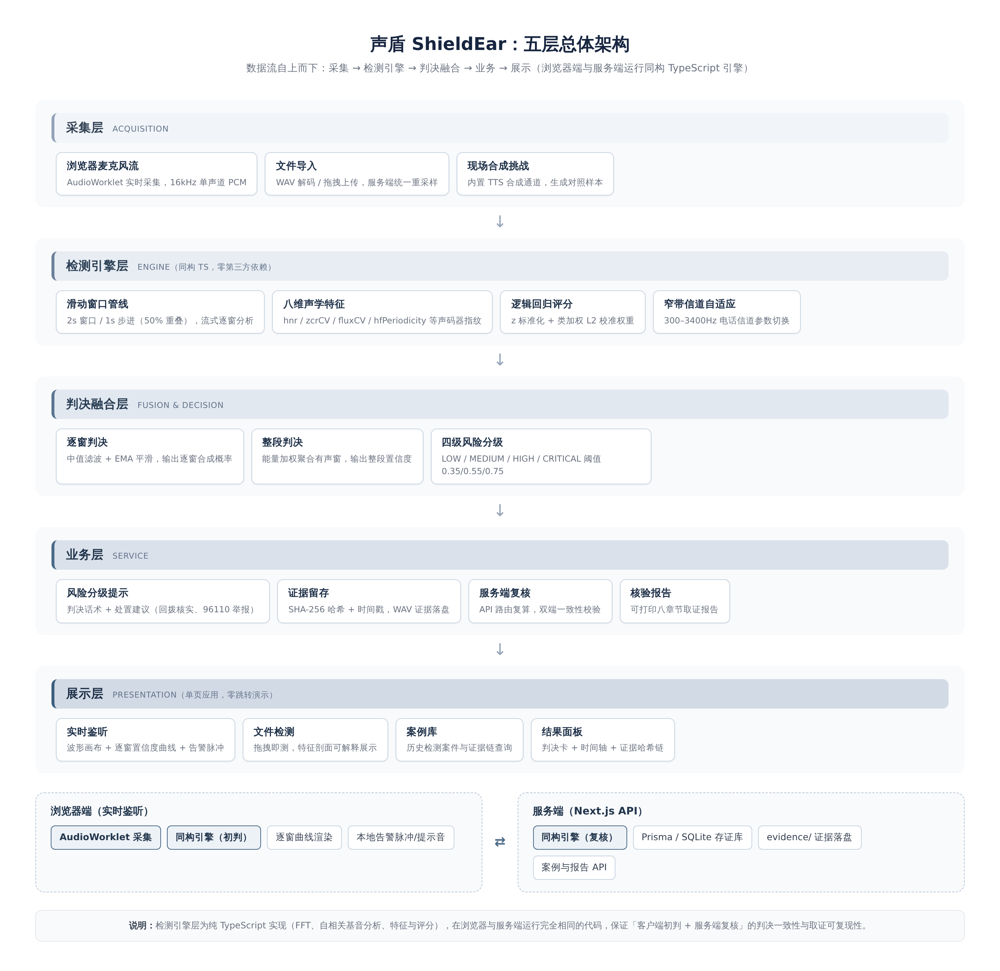

# 声盾 ShieldEar

**面向 AI 语音诈骗的实时鉴伪反诈平台** — 全国大学生信息安全竞赛作品赛参赛作品

> 接到可疑来电，如何在转账之前知道对方的声音是不是 AI 合成的？声盾把这道反诈治理中最直接的问题，变成一次可以随身携带的浏览器操作：**边通话、边检测、边存证**。

  

---

## 一句话定位

在**通话过程中**对语音流做毫秒级、可解释的 AI 合成性检测，检出伪造片段即时告警，并自动完成 SHA-256 证据固定与可打印核验报告，形成「**检测 → 告警 → 存证 → 报告**」的反诈业务闭环。

## 核心特性

| 模块 | 能力 |
|------|------|
| **实时鉴听** | AudioWorklet 16kHz 采集，2s 滑动窗口 / 1s 步进流式分析，逐窗置信度曲线与告警脉冲同屏呈现 |
| **文件检测** | 拖拽即测，输出判决卡、可疑片段时间轴与可解释的八维声学特征剖面 |
| **现场合成挑战** | 四级合成链保证任意输入文本被真实合成并当场检出，答辩现场可演示「合成 → 检测 → 告警 → 双哈希存证」完整闭环 |
| **案例库与证据链** | 检测案件入库、WAV 证据下载、音频与检测结果双 SHA-256 哈希校验 |
| **可打印核验报告** | 八章节取证报告，可直接作为 96110 举报与反诈取证材料 |

全部功能在**单页应用内零跳转**完成；浏览器端（初判）与服务端（复核）运行**同一份同构 TypeScript 引擎**，双端判决一致性由架构保证。

## 实测核心指标（纯 CPU、无 GPU）

| 指标 | 实测结果 |
|------|----------|
| 宽带检出率（合成 20/20） | **100%** |
| 窄带（电话信道）检出率 | **80%**（16/20） |
| 告警精确率（宽带 / 窄带） | **0.935 / 0.921**（检出即高可信） |
| 单窗（2s）分析时延 | 均值 6.88 ms，**P99 仅 9.15 ms** |
| 到屏判决时延 | **≤ 1.01 s**（含 1s 轮询周期） |
| 整段分析实时因子 RTF | 中位数 **0.0064**，距实时线两个数量级 |
| 跨引擎独立集（微软 Edge 神经 TTS，8 音色 × 3 新文本） | 总体正确率 **81.3%**，窄带检出 **23/24**，漏报全部为近阈值不确定档 |
| 端到端功能测试 | 8/8 用例全部通过 |

完整评测（258 条判决、混淆矩阵、鲁棒性分组、跨引擎独立集、诚实边界分析）见 [`docs/声盾-系统测试报告.docx`](docs/)。

## 系统总体架构



五层架构：采集层（AudioWorklet / 文件导入 / 现场合成）→ 检测引擎层（纯 TS 同构引擎：滑动窗口管线 + 八维声码器指纹特征 + 数据驱动校准的逻辑回归评分 + 窄带自适应）→ 判决融合层（中值 + EMA 平滑、能量加权整段判决、四级风险分级）→ 业务层（风险提示、SHA-256 证据固定、服务端复核、核验报告）→ 展示层（单页应用）。

## 快速开始

### 方式一：可执行程序包（免安装，推荐评审使用）

从本仓库 **[Releases](https://github.com/43aquarius/ShieldEar/releases/latest)** 页面下载 `ShieldEar-v1.3.1-portable.zip`（约 200MB）并解压：

- **Windows**：双击 `启动声盾-Windows.bat`（中文系统推荐）或 `START-ShieldEar.bat`（英文/其他区域设置系统兜底入口）——包内含便携 Node.js 运行时、espeak-ng 离线合成组件与 ffmpeg 转码工具，无需任何预装环境；
- **Linux（x86_64）/ macOS（Apple Silicon）**：终端执行 `bash start-shield-linux-mac.sh`（同样内置便携运行时；其他架构回退系统 Node.js ≥ 20）；
- 等待数秒浏览器自动打开 `http://127.0.0.1:3000`（端口被占用时自动改用 3001-3009 并提示实际地址），包内已含 21 件演示案件与证据 WAV 存档（含与文档记载可交叉核对的真实案件），全部功能开箱即用；
- 完全离线环境下「现场合成挑战」自动降级至 espeak-ng 真实本地合成（Windows）或预置回放，引擎来源如实标注，演示闭环不中断。

### 方式二：源码运行

```bash
# 环境要求：Node.js ≥ 20（或 bun ≥ 1.1）、SQLite
bun install            # 或 npm install
bunx prisma db push    # 初始化案例数据库（SQLite）
bun run dev            # 启动开发服务器
# 浏览器打开 http://localhost:3000
```

> 说明：「现场合成挑战」采用**四级合成通道自动选择**，保证「现场合成用户输入文本 → 当场检出」演示闭环永不中断：
> 1. 云端 TTS（z-ai 网关，需 `.z-ai-config`）—— 官方通道，含 WAF 拦截熔断与自动探活恢复；
> 2. Edge 神经 TTS（微软公共神经语音，8 个中文音色）—— 服务端纯 Node 协议栈直连（含 Sec-MS-GEC v2 DRM 移植，与 edge-tts 参考实现逐位对齐），需联网，无需 Python 环境；
> 3. espeak-ng 本地合成（完全离线兜底）—— 发行包内置 Windows 版组件与中文声库（包内绝对路径自动定位），开发环境用系统 `espeak-ng`；
> 4. 预置样本回放（仅在以上全部不可用时，响应与存证中如实标注 fallback）。
>
> 实际使用的引擎在界面徽标、API 响应（`mode`/`engine`/`engineLabel`）与数据库存证 `notes` 三处如实记录；
> 未配置任何合成依赖时，实时鉴听、文件检测、案例库与报告等其余功能不受影响。

## 测试结果一键复现

```bash
# 1. 生成鲁棒性变体样本（固定随机种子，确定性输出）
bun scripts/gen-natural-variants.ts   # 自然语音：±6dB / 1.05 变速 / 20dB 加噪
bun scripts/gen-tts-variants.ts       # 合成语音：加噪 / MP3 编解码 / 变速（需 ffmpeg）

# 2. 生成跨引擎独立集（微软 Edge 神经 TTS，8 音色 × 3 新文本，需外网可达；
#    生成结果 tts2_*.wav 已随库提交，可直接跳过本步复现报告数字）
bun scripts/gen-t2-edge-set.ts        # 输出 calibration/audio/tts2_*.wav

# 3. 执行全量测试套件（129 文件 × 双信道 = 258 条判决）
bun scripts/run-testsuite.ts          # 输出 calibration/testsuite_results.json

# 4. 重生成本次测试报告全部图表
python3 scripts/gen-test-figures.py   # 输出 download/assets/test_*.png
```

引擎权重拟合过程（`scripts/calibrate-engine.ts` + `scripts/fit-weights.ts`）与校准数据同样随库交付，全部结果可复现。

## 目录结构

```
├── src/                    # 平台源码（Next.js 16 + React 19）
│   ├── lib/engine/         # 同构检测引擎（DSP / 八维特征 / 校准 / 流式分析器）
│   ├── lib/audio/          # WAV 编解码
│   ├── lib/server/         # 分析与存证服务
│   ├── app/api/            # 检测复核 / 现场合成挑战 / 案例与证据 API
│   └── components/shield/  # 单页应用 UI（实时鉴听 / 文件检测 / 案例库 / 报告）
├── scripts/                # 校准与测试套件（含文档生成源）
├── calibration/            # 测试数据集与逐条判决记录（见 calibration/README.md）
├── docs/                   # 参赛文档：设计报告 / 测试报告 / 作品简介 / 声明 / 答辩 PPT
├── prisma/                 # 案例存证库 Schema
└── public/samples/         # 演示音频样本
```

## 参赛文档（docs/）

| 文档 | 内容 |
|------|------|
| `声盾-参赛技术报告.docx` | 系统设计方案：功能、指标、实现原理、总体架构图、软件流程图、九章节完整技术文档（24 页） |
| `声盾-系统测试报告.docx` | 测试设备、测试数据、结果分析、实现功能、特色：258 条判决全量评测（含跨引擎独立集，21 页） |
| `声盾-作品简介.docx` | 两页速览：定位、功能、指标、创新点 |
| `声盾-参赛作品声明.docx` | 版权、原创性、开源组件、技术公开与数据合规声明 |
| `声盾-答辩演示.pptx` | 13 页答辩演示（含讲者备注）+ PDF 预览版 |
| `figures/` | 全部图表原图（架构图、流程图、混淆矩阵、实时性等） |

## 数据来源与合规

- **自然人声**：wavesurfer.js / MDN 公开演示音频、公有领域有声书（LibriVox），统一重采样 16kHz；
- **合成语音**：z-ai 神经 TTS（7 音色 × 3 文本）授权生成；
- 全部样本不含可识别特定自然人的个人信息，不涉及个人信息与生物识别信息保护相关法律义务；
- 开源组件（Next.js / React / Tailwind / shadcn/ui / Prisma / recharts 等）均按原始开源许可使用并保留版权声明，完整映射见技术报告附录 B。

## 已知边界（诚实声明）

轻量引擎的判别力上限低于深度集成模型（如 ASVspoof 基线体系）；重压缩公有领域有声书存在样本特异性误报；MP3 编解码与窄带复合退化会降低召回（详见测试报告第八章）。声盾的定位是**第一道实时防线 + 反诈业务闭环**，深度模型交叉验证的第二阶段路线已在规划中。

## 团队

- **参赛队伍**：你们说的对
- **参赛单位**：大连理工大学
- **团队成员**：谭畅 等 2 人
- **开源仓库**：github.com/43aquarius/ShieldEar
