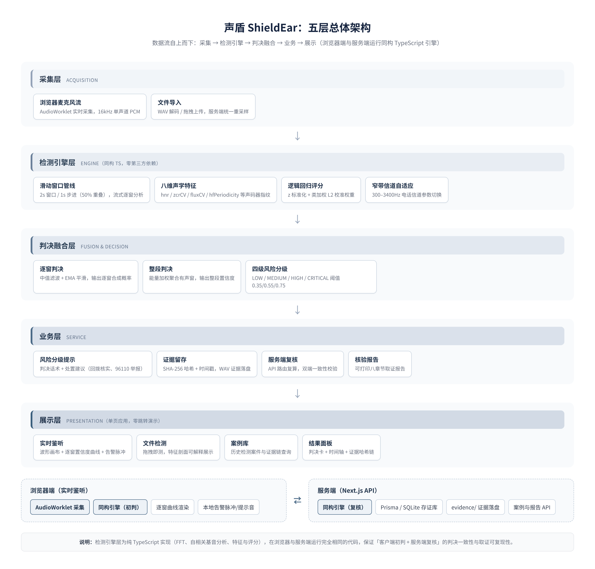

# 声盾 ShieldEar

**面向 AI 语音诈骗的实时鉴伪反诈平台** — 全国大学生信息安全竞赛作品赛参赛作品

> 接到可疑来电，如何在转账之前知道对方的声音是不是 AI 合成的？声盾把这道反诈治理中最直接的问题，变成一次可以随身携带的浏览器操作：**边通话、边检测、边存证**。

    

---

## 一句话定位

在**通话过程中**对语音流做毫秒级、可解释的 AI 合成性检测，检出伪造片段即时告警，并自动完成 SHA-256 证据固定与可打印核验报告，形成「**检测 → 告警 → 存证 → 报告**」的反诈业务闭环。

## 核心特性

| 模块 | 能力 |
|------|------|
| **实时鉴听** | AudioWorklet 16kHz 采集，2s 滑动窗口 / 1s 步进流式分析，逐窗置信度曲线与告警脉冲同屏呈现 |
| **文件检测** | 拖拽即测，输出判决卡、可疑片段时间轴与可解释的十一维声学特征剖面；包内预置 AI 合成诈骗样本与真人对照样本，开箱即可演示检测能力 |
| **案例库与证据链** | 检测案件入库、WAV 证据下载、音频与检测结果双 SHA-256 哈希校验；原始上传文件随证落盘，核验页「原始来源」检查真实可执行（v1.3.9） |
| **存证包离线导出** | 任一案例一键导出 ZIP（证据音频 + 原始来源 + 案例全量记录 + 核验报告 + SHA-256 清单），解包后 `sha256sum -c` 可独立校验（v1.3.9） |
| **证据完整性核验** | 一键重读证据 WAV 并重算 SHA-256 与入库值比对，绿色印章证明证据自存证以来未被篡改 —「存证 → 验真」闭环的验真端（v1.3.5；v1.3.9 起原始来源文件随证落盘，核验真正可执行） |
| **系统自检** | 一键体检数据引擎、证据目录、引擎校准、离线声明四项，逐项打勾全绿即就绪（v1.3.5；v1.3.11 起四项口径） |
| **可打印核验报告** | 八章节取证报告，可直接作为 96110 举报与反诈取证材料 |

全部功能在**单页应用内零跳转**完成；浏览器端（初判）与服务端（复核）运行**同一份同构 TypeScript 引擎**，双端判决一致性由架构保证。

## 实测核心指标（纯 CPU、无 GPU）

| 指标 | 实测结果 |
|------|----------|
| 宽带检出率（合成 20/20） | **100%** |
| 窄带（电话信道）检出率 | **80%**（16/20） |
| 告警精确率（宽带 / 窄带） | **0.935 / 0.921**（检出即高可信） |
| 单窗（2s）分析时延 | 均值 6.88 ms，**P99 仅 9.15 ms** |
| 到屏判决时延 | **≤ 1.01 s**（含 1s 轮询周期） |
| 整段分析实时因子 RTF | 中位数 **0.0064**，距实时线两个数量级 |
| 跨引擎独立集（微软 Edge 神经 TTS，8 音色 × 3 新文本） | 总体正确率 **81.3%**，窄带检出 **23/24**，漏报全部为近阈值不确定档 |
| 端到端功能测试 | 8/8 用例全部通过 |

完整评测（258 条判决、混淆矩阵、鲁棒性分组、跨引擎独立集、诚实边界分析）见 [`docs/声盾-系统测试报告.docx`](docs/)。

## 系统总体架构



五层架构：采集层（AudioWorklet / 文件导入）→ 检测引擎层（纯 TS 同构引擎 v2.0：滑动窗口管线 + 十一维声学特征（声码器指纹 × 8 + 韵律动态/振幅微扰/音节律调制 × 3）+ 数据驱动校准的逻辑回归评分 + 窄带自适应）→ 判决融合层（中值 + EMA 平滑、能量加权整段判决、四级风险分级）→ 业务层（风险提示、SHA-256 证据固定、服务端复核、核验报告）→ 展示层（单页应用）。

## 快速开始

### 方式一：可执行程序包（免安装，推荐评审使用）

从本仓库 **[Releases](https://github.com/43aquarius/ShieldEar/releases/latest)** 页面下载 `ShieldEar-v1.3.12-portable.zip`（约 58MB）并解压：

- **Windows**：双击 `START-ShieldEar.bat`——包内含便携 Node.js 运行时与 VC++ 2015-2022 运行库三 DLL（app-local），无需任何预装环境；启动时自动完成启动自检（数据引擎/数据库/校准数据），异常会在启动窗口给出中文提示并写入 `STARTUP-ERROR.txt`，不再出现含义不明的页面报错；
- 等待数秒浏览器自动打开 `http://127.0.0.1:3000`，包内已含 4 件演示案件（真人×2 / 神经合成×2）与对应证据存档（含原始来源文件），全部功能开箱即用；
- **Release 包为「纯离线发行版」**：检测、存证、核验全程本地运行，零联网依赖，断网开箱即用；
- **v1.3.12 变更（引擎 v2.0.0-calibrated 学术增强）**：参照 ASVspoof / ADD 挑战赛与 TIFS、USENIX Security 等学术文献重构检测引擎——新增三维权韵律特征（基频韵律动态 f0Std / 振幅微扰 shimmer / 4–8Hz 包络调制占比 envMod45，宽带计分），修复自 v1 起窄带信道判定从未触发的潜伏缺陷（3.25kHz 幅度占比 → 3.5kHz 功率占比）；测试套件引入 EER/AUC 学术口径指标。全套 258 判决对比上一入库基线（v1.3.0 引擎实录）：宽带 F1 0.893→0.962、整体正确 209/258→226/258、综合 EER 0.18 / AUC 0.925；相位域 MGD 类与倒谱纹理类特征经探针实证分离不足，诚实不入引擎（scripts/probe-v2-features.ts 可复现）；
- **v1.3.11 变更**：移除「现场合成挑战」功能及全部本地语音合成组件（espeak-ng 引擎与声库，约 27MB）——真机实测其机器音质不达标，为保持产品诚实与专注，平台聚焦「检测、存证、核验」核心能力。检测演示动线不受影响：文件检测内置合成诈骗与真人对照样本，实时鉴听对外放音频即可实时告警；
- **常见问题（排障史）**：v1.3.7 曾把 0xC0000135 误诊为「缺 VC++ 运行库」；v1.3.8 定位为包内 DLL 文件名不匹配并双文件名随包；v1.3.9 坐实更深一层根因 —— 构建工具（Turbopack）把 `process.platform === "win32"` 按构建机（Linux）常量折叠，导致应用内组件探测从未成功过，现已改为平台无关按名探测 + 打包硬闸防复发。以上均针对已移除的合成组件（历史供源码考古）；当前包内 PE 仅 node.exe / Prisma 引擎 / VC++ 三 DLL，由打包期 PE 导入表硬闸逐一校验，**无需安装任何运行库**。

### 方式二：源码运行

```bash
# 环境要求：Node.js ≥ 20（或 bun ≥ 1.1）、SQLite
bun install            # 或 npm install
bunx prisma db push    # 初始化案例数据库（SQLite）
bun run dev            # 启动开发服务器
# 浏览器打开 http://localhost:3000
```

> 说明（v1.3.11 起）：合成挑战功能（含本地 espeak-ng 合成、云端 TTS 通道与四级合成链）已整体移除，源码与发行包均不再包含任何语音生成路径 —— 平台专注「检测 → 告警 → 存证 → 报告」主线。旧合成路由 `/api/tts-challenge` 与 `/api/config/cloud` 已下线（404）。

## 测试结果一键复现

```bash
# 1. 生成鲁棒性变体样本（固定随机种子，确定性输出）
bun scripts/gen-natural-variants.ts   # 自然语音：±6dB / 1.05 变速 / 20dB 加噪
bun scripts/gen-tts-variants.ts       # 合成语音：加噪 / MP3 编解码 / 变速（需 ffmpeg）

# 2. 生成跨引擎独立集（微软 Edge 神经 TTS，8 音色 × 3 新文本，需外网可达；
#    生成结果 tts2_*.wav 已随库提交，可直接跳过本步复现报告数字）
bun scripts/gen-t2-edge-set.ts        # 输出 calibration/audio/tts2_*.wav

# 3. 执行全量测试套件（129 文件 × 双信道 = 258 条判决）
bun scripts/run-testsuite.ts          # 输出 calibration/testsuite_results.json

# 4. 重生成本次测试报告全部图表
python3 scripts/gen-test-figures.py   # 输出 download/assets/test_*.png
```

引擎权重拟合过程（`scripts/calibrate-engine.ts` + `scripts/fit-weights.ts`）与校准数据同样随库交付，全部结果可复现。

## 开发与质量保障（v1.3.13–v1.3.14）

v1.3.13 为工程强化版：引入 **vitest 单元测试体系**与 **GitHub Actions CI**，为引擎装上持续质量门；v1.3.14 为安全加固版：修复证据链路由路径遍历缺陷 + 全站 HTTP 安全响应头，并为服务层补齐单测（126 项）。

```bash
npm run typecheck   # TypeScript 严格类型检查（src/）
npm run lint        # ESLint（src/，零告警）
npm run test        # 单元测试套件（126 项）
```

测试体系五层结构：

| 层 | 文件 | 锚定内容 |
|----|------|----------|
| **DSP 数学契约** | `src/lib/engine/__tests__/dsp.test.ts` | FFT（冲激/单频/Parseval/线性性/逆变换往返）、Kaiser sinc 重采样保真与抗混叠（v1.3.9 重写的回归钉） |
| **特征注入响应** | `features.test.ts` | 合成信号逐维验证：零扰动下 jitter/shimmer/f0Std 精确为零，注入扰动后各特征定向响应；3.5kHz 功率占比信道判定（v2.0 修复的回归钉） |
| **校准与指标契约** | `calibration.test.ts` · `metrics.test.ts` | z 标准化/限幅/逐特征单调性/窄带零权重不变性；EER/AUC 解析已知分布对拍 |
| **真实数据回归** | `regression.test.ts` | 50 条真实特征向量重放（宽带 AUC 0.93 / 窄带 0.90）；引擎版本/参数/阈值与 258 条基线快照逐字段锚定；metrics 抽取前后 EER/AUC 逐位一致 |
| **服务层与存证包** | `src/lib/server/__tests__/`（v1.3.14） | 案件编号格式闸（路径遍历载荷逐一钉死）与证据路径容器闸；存证包 ZIP 构建器（CRC-32 公开校验向量对拍 + 迷你解析器往返 + Python zipfile 交叉验证） |

推送 main 即触发 CI（类型检查 → Lint → 单测 → standalone 构建冒烟），状态徽章见顶部。WAV 解码器同版加固：损坏头部（声道数/采样率/位宽非法、fmt 截断、空 data 块）从晦涩的 RangeError 变为可读错误信息；修复实时鉴听面板一处 React 19 渲染期 ref 访问违例。

### 安全加固（v1.3.14）

自审计发现并修复一处证据链路由缺陷：`/api/evidence/[caseNo]` 历史上未查库先读文件，未校验的 `caseNo` 直接拼入证据路径，`%2E%2E%2F` 编码段可路径遍历逃逸 `evidence/` 目录。修复采用双重独立防线：

1. **格式闸**：全部 5 个 `[caseNo]` 路由入口校验 `^SS-\d{8}-\d{4}$`（服务端编号生成器的唯一产出格式），非法输入 400 早退；
2. **容器闸**：`evidencePath` 改用 `resolveInsideDir` 解析并断言结果仍在 `evidence/` 内，即使未来新增调用方绕过格式闸也无路可逃。

同时补齐全站 HTTP 安全响应头（`next.config.ts`）：`X-Content-Type-Options: nosniff`、`X-Frame-Options: DENY`（阻断将核验页面 iframe 嵌套伪造「核验通过」假象）、`Referrer-Policy: no-referrer`、`Permissions-Policy`（仅保留实时鉴听所需麦克风）与 CSP —— 其中 `connect-src 'self'` 使「全程零外连」的离线声明获得传输层强制执行：任何违背声明的网络请求将被浏览器直接拦截。

## 目录结构

```
├── src/                    # 平台源码（Next.js 16 + React 19）
│   ├── lib/engine/         # 同构检测引擎（DSP / 十一维特征 / 校准 / 流式分析器 / EER·AUC 指标）
│   │   └── __tests__/      # 单元测试（DSP 契约 / 特征注入 / 校准 / 真实数据回归）
│   ├── lib/audio/          # WAV 编解码（含头部合法性闸）
│   ├── lib/server/         # 分析与存证服务（含案件编号闸与证据路径容器闸）
│   │   └── __tests__/      # 服务层单测（路径遍历攻击面 / ZIP 构建器契约）
│   ├── app/api/            # 检测复核 / 案例与证据 / 自检 API
│   └── components/shield/  # 单页应用 UI（实时鉴听 / 文件检测 / 案例库 / 报告）
├── scripts/                # 校准与测试套件（含文档生成源）
├── calibration/            # 测试数据集与逐条判决记录（见 calibration/README.md）
├── docs/                   # 参赛文档：设计报告 / 测试报告 / 作品简介 / 声明 / 答辩 PPT
├── prisma/                 # 案例存证库 Schema
└── public/samples/         # 演示音频样本
```

## 参赛文档（docs/）

| 文档 | 内容 |
|------|------|
| `声盾-参赛技术报告.docx` | 系统设计方案：功能、指标、实现原理、总体架构图、软件流程图、九章节完整技术文档（24 页） |
| `声盾-系统测试报告.docx` | 测试设备、测试数据、结果分析、实现功能、特色：258 条判决全量评测（含跨引擎独立集，21 页） |
| `声盾-作品简介.docx` | 两页速览：定位、功能、指标、创新点 |
| `声盾-参赛作品声明.docx` | 版权、原创性、开源组件、技术公开与数据合规声明 |
| `声盾-答辩演示.pptx` | 13 页答辩演示（含讲者备注）+ PDF 预览版 |
| `声盾-答辩演示手册.docx` | 队内彩排资料：演示前检查清单、五幕演示剧本、关键数字速查卡、应急预案、评委八问（2026-11 实拍截图） |
| `figures/` | 全部图表原图（架构图、流程图、混淆矩阵、实时性等） |

## 数据来源与合规

- **自然人声**：wavesurfer.js / MDN 公开演示音频、公有领域有声书（LibriVox），统一重采样 16kHz；
- **合成语音**：z-ai 神经 TTS（7 音色 × 3 文本）授权生成，语料 `calibration/audio/` 已随库交付（v1.3.11 起生成脚本随合成通道退役，历史版本可考 git 记录）；
- 全部样本不含可识别特定自然人的个人信息，不涉及个人信息与生物识别信息保护相关法律义务；
- 开源组件（Next.js / React / Tailwind / shadcn/ui / Prisma / recharts 等）均按原始开源许可使用并保留版权声明，完整映射见技术报告附录 B。

## 已知边界（诚实声明）

轻量引擎的判别力上限低于深度集成模型（如 ASVspoof 基线体系）；重压缩公有领域有声书存在样本特异性误报；MP3 编解码与窄带复合退化会降低召回（详见测试报告第八章）。声盾的定位是**第一道实时防线 + 反诈业务闭环**，深度模型交叉验证的第二阶段路线已在规划中。

## 团队

- **参赛队伍**：你们说的对
- **参赛单位**：大连理工大学
- **团队成员**：谭畅 等 2 人
- **开源仓库**：github.com/43aquarius/ShieldEar
